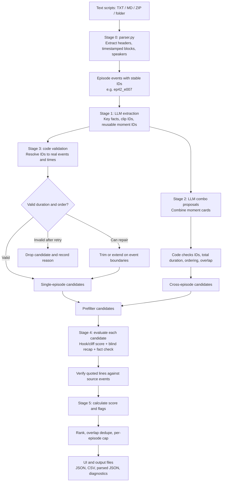

# Promo Finder: Flow, Scoring, and Results

## What the project does

Promo Finder reads screenplay text with timestamps and proposes short promo clips. It uses an LLM to identify story moments and Python code to resolve event IDs, validate clip boundaries, score candidates, and export results. It analyzes script text; it does not inspect finished video, performances, music, or visuals.

## Project flow



The executable entry points are `app.py` (Streamlit) and `cli.py` (command line). Both call `promo_finder/pipeline.py`. The parser is in `promo_finder/parser.py`; duration and segment validation are in `promo_finder/segments.py`; prompts are stored in `prompts/`; tunable settings are in `config.yaml` and `promo_finder/config.py`.

### Stage summary

| Stage | Work | Result |
|---|---|---|
| 0 Parse | Read timestamped screenplay blocks and assign stable event IDs | Episodes, events, and parser warnings |
| 1 Extract | Ask the LLM for key facts, continuous clip candidates, and short moments | ID-based suggestions per episode |
| 2 Combine | Ask the LLM to pair moment cards into promos | Proposed multi-piece combos |
| 3 Validate | Resolve IDs to actual events/times; check ordering and configured duration; repair or retry invalid suggestions | Valid candidates, or recorded drop reasons |
| 4 Evaluate | Score hook and ending, make a blind recap, compare recap with episode facts | Hook/cliff scores and standalone match estimate |
| 5 Rank | Calculate weighted score, add review flags, remove overlapping clips, apply per-episode maximum | Ordered promo list |

## Scoring mechanism

Each candidate receives three component scores on a 1–5 scale:

- **Hook:** LLM judges the opening seconds for an attention-grabbing line or action.
- **Cliffhanger:** LLM judges whether the ending leaves an unresolved question, threat, or reveal.
- **Standalone:** The LLM writes a recap from the candidate alone. A separate comparison checks that recap against the episode's extracted key facts. Python computes `match = correctly covered facts / total facts`, then converts it to a 1–5 scale with `standalone = match × 5`.

The default overall score is:

```text
overall = 0.35 × standalone + 0.35 × hook + 0.30 × cliffhanger
```

The weights are configurable (`w_standalone`, `w_hook`, and `w_cliff` in `config.yaml`). A candidate with an unverified scorer quote has that hook or cliff score capped at `unverified_cap` (default 3). The quoted line must match text from the cited event ID.

After scoring, candidates are sorted by overall score. Ranking then removes candidates whose overlap with an already-kept candidate exceeds `overlap_max` (default 0.5) and enforces `per_episode_max` (default 3), counted against the first or “hook” episode in a combo. Flags are for editorial review; they do not directly lower the score.

## Candidate flags

| Flag | Meaning |
|---|---|
| `needs_context` | Fewer than the configured fraction of episode facts were covered by the blind recap. |
| `no_key_facts` | No facts were available for the comparison, so standalone-ness could not be measured. |
| `weak_hook` | Hook score is at or below `weak_hook_max` (default 2). |
| `resolved_ending` | Cliffhanger score is at or below `resolved_ending_max` (default 2). |
| `cut_mid_sentence` | The final event text does not end in one of the configured terminal characters. |
| `cross_episode` | Candidate contains segments from more than one episode. This describes the candidate; it is not inherently a quality failure. |
| `hook_quote_unverified` | Scorer's hook quote could not be verified against the cited event text. |
| `cliff_quote_unverified` | Scorer's ending quote could not be verified against the cited event text. |

## Pipeline health statuses

The debug report uses `PASS`, `WARN`, and `FAIL` for diagnostic checks. These are **not** the candidate's overall score and are not a single project-wide approval status.

- **PASS** means that particular check met its condition.
- **WARN** means a soft check found something to inspect, such as missing loglines, low combo yield, or unverified quotes. It can be expected for some shows.
- **FAIL** means a check's required condition did not hold. Review its detail and suggested fix. Some failures are marked as warnings when partial output is still usable.

The final run status is represented by the produced results and diagnostics: successful runs show ranked promos and a health report; fatal setup/API errors stop the run with an error and hint; individual failed calls are recorded in the run metadata and call log. The CLI exits `0` when promos are produced, `2` when the run completes with no promos, and `1` on a run failure. The Streamlit UI displays run errors and their hints.

## Results and files

The output folder (default `output/`) contains:

| File | Contents |
|---|---|
| `promos.json` | Ranked promos, timestamps in readable and numeric form, component scores, overall score, flags, blind recap, and missing facts |
| `promos.csv` | Editor-friendly promo table plus blank `human_ok(y/n)` and `human_note` columns for review |
| `parsed/epXX.json` | Parsed events for each episode |
| `run_meta.json` | Model, run time, aggregate counts, stage durations, and failed items |
| `health_report.txt` | Stage-by-stage quality checks and diagnostic details |
| `llm_calls.jsonl` | One row per model attempt, including schema, status, duration, and error |
| `debug_samples.json` | First captured request and response sample for each output schema |

The Streamlit app also displays parsed events, ranked promo rows, flags, recaps, missing facts, and debug information, and provides download buttons for JSON and CSV.

## One-minute explanation

> “Promo Finder parses timed screenplay text into events with stable IDs. An LLM proposes clips and reusable moments by ID, and Python resolves those IDs to real timestamps, validates durations, and repairs or drops invalid suggestions. It can also combine moments across episodes. Each candidate is judged for its opening hook, ending cliffhanger, and how well a blind recap matches the episode facts. Python combines those scores, checks quoted evidence, flags issues, removes overlapping candidates, and exports a ranked list for an editor to review.”
